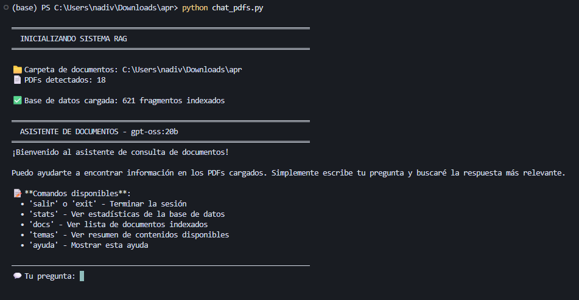
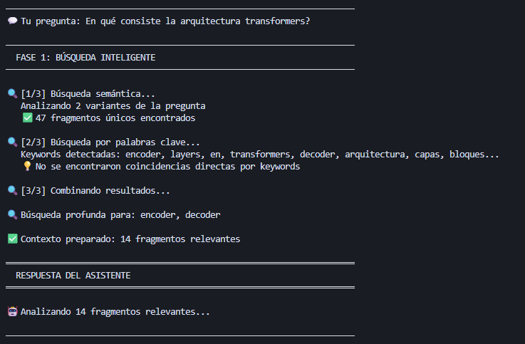
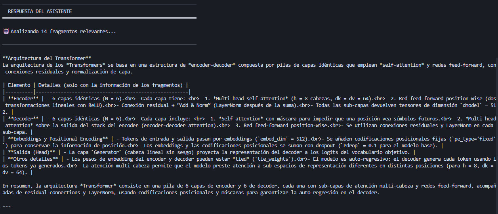
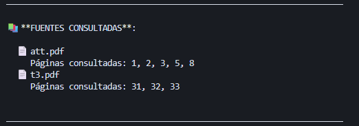

# PDF RAG Chat

**A terminal chatbot that answers questions about your own PDFs, fully local, using Ollama and ChromaDB with hybrid (semantic plus keyword) retrieval and page-level citations.**

> **Context.** Built in February 2026 as a personal project, when I was working at Grupo CEU on retrieval-based assistants and finishing my Computer Engineering degree at UPV. It is an early, single-file take on local RAG, a first prototype and not the production-grade style of my recent projects.



## What it does

- Indexes every PDF in the working folder into a persistent local ChromaDB database, only on the first run (when the collection is empty).
- Answers questions in a terminal chat, streaming the answer from a local Ollama chat model.
- Combines semantic search with keyword search and fuses the rankings with Reciprocal Rank Fusion.
- Cites the document and the pages used for every answer.
- Includes chat commands: `temas` (topic summary), `docs` (indexed documents), `stats` (database statistics), `ayuda` (help), `salir` (exit).
- Replies with a friendly message when nothing relevant is found or the question is outside the documents. The interface and prompts are in Spanish.

## How it works

Everything lives in `chat_pdfs.py`.

1. **Indexing.** `pypdf` extracts the text of each page. Each page is split into chunks of 800 characters with 200 of overlap (chunks under 100 characters are dropped). Each chunk is embedded with `nomic-embed-text` through Ollama and stored in ChromaDB with its source file, page, chunk number and number of chunks in the page.
2. **Semantic search.** The question is turned into up to three queries (the original, a shortened one, and one made of recognised technical terms). Each is embedded and the 25 nearest chunks are retrieved; positions are accumulated as RRF scores.
3. **Keyword search.** Keywords are extracted from the question (stopwords removed, technical terms kept) and expanded with a small hand-written dictionary (for example `attention` adds `query`, `key`, `value`, `softmax`). Each keyword, in several letter-case variants, is searched with ChromaDB's `$contains` document filter.
4. **Exhaustive scan.** If the question contains certain critical terms (a fixed list about Transformers: `query`, `key`, `value`, `encoder`, `decoder`, `attention`, and so on), the whole collection is scanned with word-boundary regexes and matching chunks get an extra boost.
5. **Fusion.** Final score is 0.6 times the semantic score plus 0.4 times the keyword score. If the best score is below 0.02 the question is treated as out of scope.
6. **Context and answer.** The top 12 chunks are kept, the neighbouring chunks of the first 6 are added, and everything is placed in a prompt that tells the model to answer only from the fragments and to cite document and page. The answer is streamed and the consulted sources are printed.

The keyword expansion and the critical-term list are tuned to the sample documents (Transformers and LLMs), so retrieval on other topics relies mostly on the semantic and plain keyword parts.

### Screenshots

Hybrid search finding fragments:



The assistant answering from the retrieved context:



The sources consulted after an answer:



## Run it

Requires Python and [Ollama](https://ollama.com/) running locally. I did not run the project while writing this README; the commands below follow the code and are not verified by execution.

```bash
pip install -r requirements.txt
ollama pull nomic-embed-text
ollama pull gpt-oss:20b          # default chat model; change MODELO_CHAT in chat_pdfs.py to use another
```

The script reads the PDFs from the current working directory (`CARPETA_DOCS = "."`) and creates `mi_vector_db/` there. To try it with the sample PDFs, run it from inside `pdfs/`:

```bash
cd pdfs
python ../chat_pdfs.py
```

or copy your own PDFs next to the script (root PDFs are ignored by git) and run `python chat_pdfs.py`. If you change the embedding model or the documents, delete `mi_vector_db/` so the collection is rebuilt.

The models are set at the top of `chat_pdfs.py` (`MODELO_CHAT`, `MODELO_EMBEDDING`), together with the chunking and retrieval parameters.

## Repository layout

```
chat_pdfs.py        whole application: indexing, hybrid retrieval, chat loop
requirements.txt    ollama, chromadb, pypdf
pdfs/               sample documents (Spanish course notes on Transformers, LLMs, RLHF,
                    PyTorch and Hugging Face, plus the "Attention Is All You Need" paper)
imgs/               screenshots used in this README
```

## Stack

Python, Ollama (`gpt-oss:20b`, `nomic-embed-text`), ChromaDB, pypdf.
